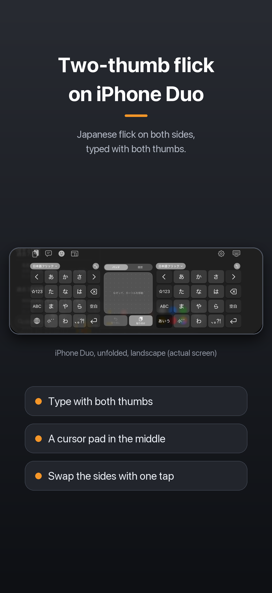
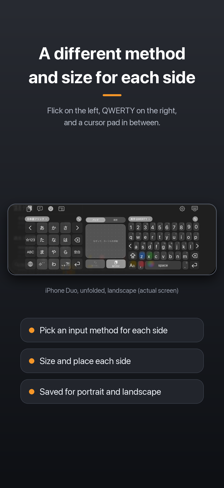
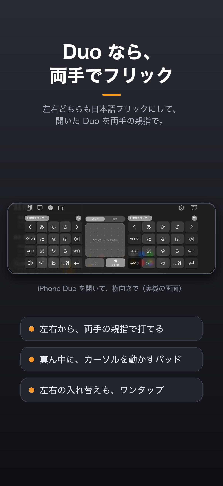
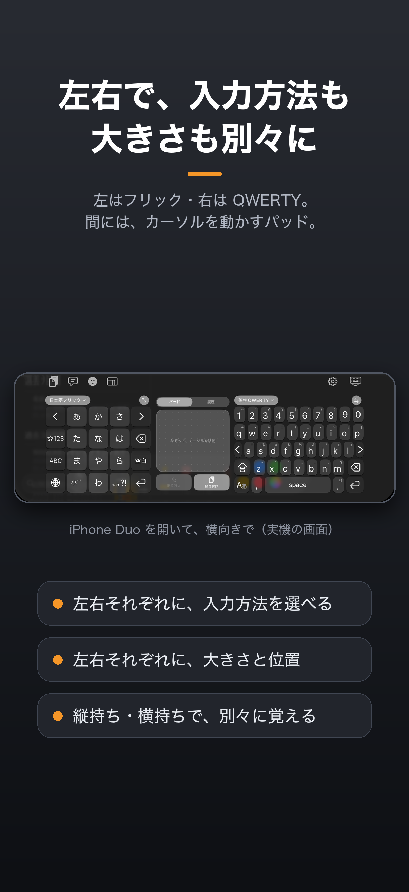

# Keyboardist for iPhone Duo

A Japanese and English keyboard built around moving the cursor — now with a true split layout for iPhone Duo.
Made by Glyphe, a one-person studio in Japan. No ads, no tracking, no account.

## What's new for iPhone Duo
- **A split keyboard along the fold.** Each half can use its own input method: Japanese flick on both sides for two-thumb typing, or flick on one side and English QWERTY on the other.
- **Size and place each side on its own**, saved separately for portrait and landscape.
- **A center pad between the halves**: swipe to move the cursor, open your copy history, and add the buttons you choose.
- **Duo Writing Desk**: half-fold your Duo like a tiny laptop, and the top screen becomes vertical Japanese manuscript paper.

The built-in iOS keyboard also splits on iPhone Duo, but it can't mix input methods or size each side separately.

[Download on the App Store](https://apps.apple.com/app/id6825295043) · Contact: Glyphe.info@gmail.com

---

# Keyboardist（iPhone Duo 版）

カーソル操作を大切にした日本語・英語のキーボード。iPhone Duo を開くと、キーボードが左右に分かれます。

- 左右それぞれに入力方法を選べます（左右ともフリックで両手入力／左はフリック・右は英字 QWERTY など）
- 左右それぞれの大きさと位置を、縦持ち・横持ちで別々に覚えます
- 左右の間に、カーソルを動かすパッドとコピー履歴
- 半分に折ると、上の画面が縦書きの原稿用紙になる「Duo の執筆台」

[App Store で見る](https://apps.apple.com/jp/app/id6825295043) ・ お問い合わせ: Glyphe.info@gmail.com
